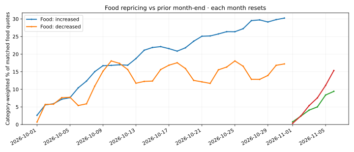
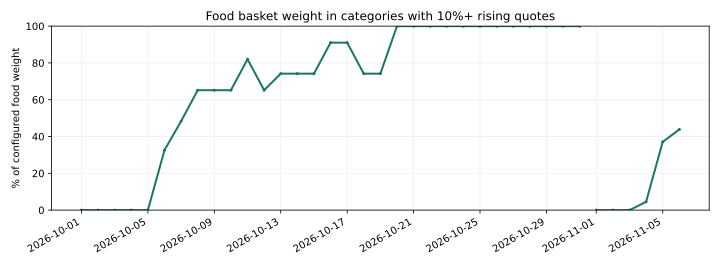
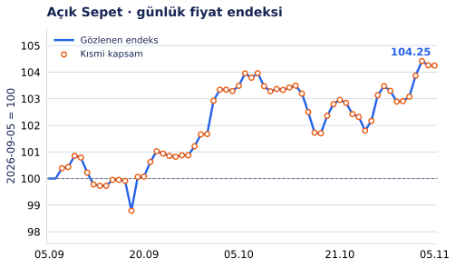
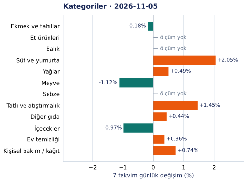
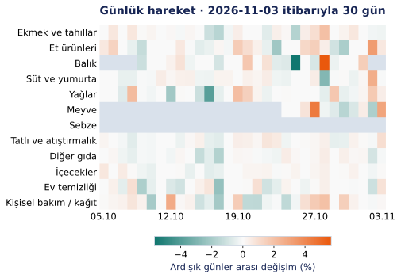
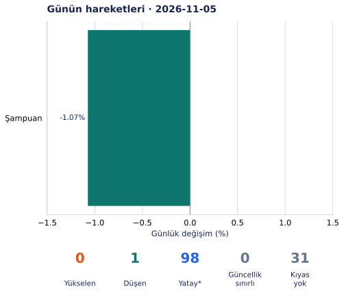
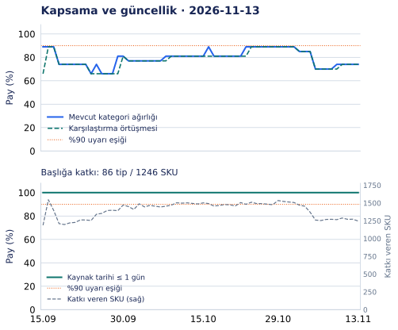
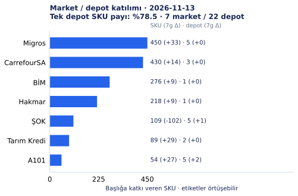

# Açık Sepet — ECB Repricing Research

> **Experimental branch:** ECB-inspired daily supermarket price-setting analysis. This branch is separate from the official Açık Sepet v0.4 publication. The results are **provisional**, and large observed price moves require promotion/source verification.

<!-- ECB_RESEARCH_START -->
## ECB-style supermarket repricing research — provisional

**Last observation:** 2026-11-07 · **1,809 comparable store–SKU quotes**. This experiment uses the existing main-branch snapshots, without additional scraping.

| Metric | Result |
|:--|--:|
| Food-only increasing quotations | **9.31%** |
| Food-only decreasing quotations | **17.42%** |
| All-basket increasing quotations | 9.88% |
| All-basket decreasing quotations | 16.60% |
| All-basket unchanged quotations | 73.51% |
| Food repricing breadth (≥10% increases in category) | 43.82% |
| Research-category weight represented | 100.00% |

**Like-for-like calendar comparison (all-basket increase frequency):** -2.59 percentage points versus 2026-10-07

### Repricing frequency (monthly baseline, daily updates)

### Breadth of food repricing

### Important quality warning

**280 of 1812 raw matched store-SKU prices (15.5%) moved ≥20%** between previous month-end and latest observation; 4 approximately doubled. Promotion reversals are plausible but not confirmed. Price-change magnitudes are **not validated as structural repricing**.

Category-weight coverage means represented categories passed the minimum
of five matched quotes; it **does not** mean a representative full basket.
The sample covers specific supermarket depots, not the Turkish population.
Do not interpret the series as official inflation or as an established
leading indicator. The ECB analyzes euro-area food prices with official
HICP weights and fuller promotion handling; these levels are not directly comparable.

**[Methods and limitations](research/ecb/README.md)** · **[Latest details](research/ecb/output/latest.md)** · **[Quality diagnostics](research/ecb/output/quality.json)** · **[Daily series](research/ecb/output/daily_repricing.csv)** · **[ECB article](https://www.ecb.europa.eu/press/blog/date/2026/html/ecb.blog20261102~871cc494e2.en.html)**
<!-- ECB_RESEARCH_END -->

---

## Reference: original Açık Sepet price index

The existing v0.4 index below is a **snapshot of the production project at this branch point**, not the ECB-style research result. [See current production README](https://github.com/onurcan-b/acik-sepet/tree/main#readme).

Türkiye'de market ürünlerinin günlük fiyat hareketini izleyen açık, deneysel gösterge.

<!-- STATUS_START -->
> **Veri durumu: Kısmi güncelleme; bazı tiplerde gün içindeki önceki ölçüm korundu.** Son seri noktası: **2026-11-06**. Kategori ağırlığı kapsaması: **%70**. Güncel kaynak (≤1 gün): **%100.0**.
> **Kalite uyarısı: kapsama.** [Ayrıntı](data/v0.4/quality.json).
> 3 tipte önceki ölçüm korundu; [tarama zamanı ve durum](data/v0.4/collection-status.json).
> Yayımlanamayan kategoriler: Et ve et ürünleri; Balık ve deniz ürünleri; Sebze.
> Baz: **2026-09-05 = 100**.
<!-- STATUS_END -->

Turuncu boş noktalar kısmi kapsamı; çizgideki boşluklar yayımlanamayan günleri gösterir.

<!-- STATS_START -->
| Endeks | Günlük | 7 gün | 30 gün | Bazdan beri |
|---:|---:|---:|---:|---:|
| **104.01** | -0.10% | +1.09% | +0.21% | +4.01% |

**%70** kategori ağırlığı · **82 tip / 1253 SKU** başlığa katkı · **1489 SKU** toplandı.
<!-- STATS_END -->

### Kategorilerde son yedi gün

“—” ilgili takvim tarihinde ölçüm olmadığını belirtir. Taralı çubuklarda kaynak güncelliği sınırlı veya bilinmiyor.

### Gün gün fiyat hareketi

Turuncu artış, yeşil azalış, beyaz sıfıra yakın hareket; gri karşılaştırma yok. Noktalı hücrelerde kaynak güncelliği sınırlı veya bilinmiyor.

### Bugün ne değişti?

En fazla beş artış ve beş azalış gösterilir. *Yatay*: her iki günde en az %90 güncel kaynakla ±%0,005 içinde hareket; güncelliği sınırlı kıyaslar ayrı sayılır. “Kıyas yok” paydasında eksik ürün tipleri de bulunur.

### Ölçümün sağlığı

Payda tüm sepet; eksik kategoriler çıkarılmaz. Güncellik, başlığa katkı veren SKU'ların kaynak tarihidir. %90 çizgisi operasyonel uyarı eşiğidir; temsiliyet garantisi değildir.

### Market ve depot katılımı

Başlığa katkı veren gözlemler gösterilir; parantezler yedi takvim günlük sayısal farktır. Depot, kaynaktaki mağaza kimliğidir; önceki kanıt yoksa fark “—” olur. Katılım sayıları ulusal temsiliyeti göstermez.

---

130 ürün tipi, 12 kategori; kg, litre veya adet başına karşılaştırılabilir fiyatlar. Grafikler her başarılı günlük taramayla güncellenir; baz ve yayımlanmış geçmiş korunur.

**Sınırlar:** Resmî TÜFE değildir. Kira ve hizmetler yoktur; ağırlıklar araştırma amaçlıdır, mağaza örneklemi nüfusa göre kurulmamıştır. Kampanyalar gözlenen fiyatın parçasıdır. Eksik kapsamda kalan kategoriler tüm market sepetini temsil etmeyebilir.

[Veri](data/v0.4/) · [Kalite tanıları](data/v0.4/quality.json) · [Yöntem](METHOD.md) · [Kurulum ve katkı](CONTRIBUTING.md) · [Günlük iş akışı](https://github.com/onurcan-b/acik-sepet/actions/workflows/daily.yml)

### Teşekkür ve kaynak

Fiyat ve kategori verisi [Market Fiyatı](https://marketfiyati.org.tr/) servisinden gelir. [Uygulamanın açıklamasına göre](https://marketfiyati.org.tr/uygulama-hakkinda) geliştirici **TÜBİTAK BİLGEM**'dir. İlgili kamu kurumlarına ve fiyat verisini sağlayan zincir marketlere teşekkürler. Kaynak verinin mülkiyeti ve lisansı ilgili hak sahiplerindedir.

Proje, kod ve metodoloji: **Onurcan Büyükkalkan** — [buyukkalkan.net](https://buyukkalkan.net/).
[Veri ve hukuk notu](NOTICE.md) · [Kod: MIT](LICENSE-CODE)
