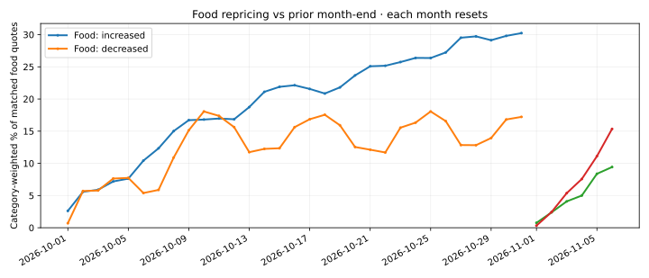
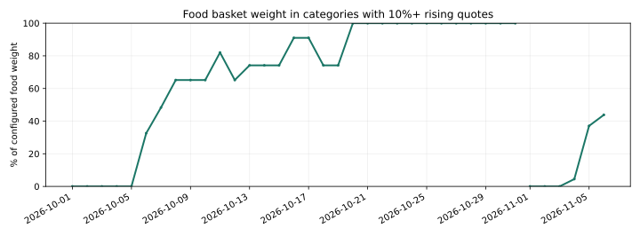

# Açık Sepet · ECB repricing experiment

**Latest: 2026-11-13 (provisional month-to-date)** · 1759 comparable store-SKU quotes · 100.0% basket-weight coverage.

**Increased:** 19.29% · **Decreased:** 18.90% · **Unchanged:** 61.80%.

**Food-only increase frequency:** 19.00% · decrease frequency: 19.29%.

**Food breadth (categories with ≥10% increasing):** 77.5% of configured food weight.

**Quality warning:** 323 / 1764 raw matched quotations (18.3%) changed by ≥20%; 4 almost doubled. Promotions and other outliers remain under investigation.

**All-basket matched previous-month same-day change:** +0.54 pp (versus 2026-10-13).

| Category | Quotes | Increases | Decreases | Avg rise | Avg fall |
|---|---:|---:|---:|---:|---:|
| Ekmek, tahıllar ve makarna | 177 | 26.0% | 21.5% | +18.97% | -25.33% |
| Et ve et ürünleri | 104 | 8.7% | 23.1% | +16.81% | -18.61% |
| Balık ve deniz ürünleri | 32 | 18.8% | 6.2% | +22.76% | -25.10% |
| Süt ürünleri ve yumurta | 241 | 28.6% | 8.3% | +7.50% | -13.79% |
| Yağlar | 96 | 16.7% | 15.6% | +41.44% | -17.21% |
| Meyve | 38 | 18.4% | 28.9% | +28.43% | -17.64% |
| Sebze | 62 | 22.6% | 35.5% | +27.46% | -15.73% |
| Şeker, tatlı ve atıştırmalık | 256 | 15.2% | 10.2% | +18.88% | -15.99% |
| Diğer gıda | 179 | 17.3% | 16.2% | +28.79% | -20.72% |
| Alkolsüz içecekler | 200 | 7.0% | 13.5% | +9.18% | -20.28% |
| Ev temizlik sarf malzemeleri | 149 | 24.8% | 14.1% | +35.75% | -36.86% |
| Kişisel bakım ve kağıt ürünleri | 225 | 16.0% | 18.7% | +15.49% | -31.08% |

Method: matched product **and** store, normalized price, same pack size;
fresh source (≤1 day), previous month-end price within seven days,
Sale-like V-shaped reductions suppressed only after an observed rebound;
this heuristic does not prove any promotion. Current sales may remain.
Excludes extreme changes(below −50% or above +100%). Category weighting uses Açık Sepet
**research weights**, not official TÜİK/HICP weights.
Coverage is based on categories with at least five comparable quotes.
This is not official inflation or the ECB Daily Price Dataset.
