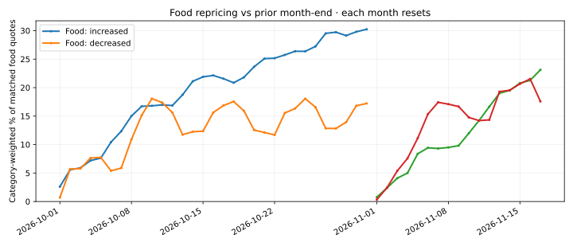

# Açık Sepet · ECB repricing experiment

**Latest: 2026-11-27 (provisional month-to-date)** · 1593 comparable store-SKU quotes · 100.0% basket-weight coverage.

**Increased:** 25.62% · **Decreased:** 19.46% · **Unchanged:** 54.92%.

**Food-only increase frequency:** 25.80% · decrease frequency: 19.56%.

**Food breadth (categories with ≥10% increasing):** 100.0% of configured food weight.

**Quality warning:** 290 / 1596 raw matched quotations (18.2%) changed by ≥20%; 3 almost doubled. Promotions and other outliers remain under investigation.

**All-basket matched previous-month same-day change:** -3.04 pp (versus 2026-10-27).

| Category | Quotes | Increases | Decreases | Avg rise | Avg fall |
|---|---:|---:|---:|---:|---:|
| Ekmek, tahıllar ve makarna | 165 | 37.0% | 16.4% | +17.00% | -19.32% |
| Et ve et ürünleri | 93 | 14.0% | 17.2% | +13.22% | -23.95% |
| Balık ve deniz ürünleri | 29 | 20.7% | 3.4% | +36.41% | -42.86% |
| Süt ürünleri ve yumurta | 230 | 42.6% | 7.8% | +9.09% | -13.46% |
| Yağlar | 95 | 17.9% | 16.8% | +39.83% | -19.36% |
| Meyve | 33 | 15.2% | 39.4% | +14.30% | -19.29% |
| Sebze | 50 | 30.0% | 42.0% | +24.15% | -19.70% |
| Şeker, tatlı ve atıştırmalık | 232 | 20.7% | 17.7% | +15.08% | -20.93% |
| Diğer gıda | 163 | 21.5% | 16.6% | +22.41% | -14.69% |
| Alkolsüz içecekler | 170 | 15.9% | 8.8% | +8.57% | -19.92% |
| Ev temizlik sarf malzemeleri | 127 | 24.4% | 21.3% | +22.85% | -22.38% |
| Kişisel bakım ve kağıt ürünleri | 206 | 23.8% | 14.1% | +16.38% | -29.82% |

Method: matched product **and** store, normalized price, same pack size;
fresh source (≤1 day), previous month-end price within seven days,
Sale-like V-shaped reductions suppressed only after an observed rebound;
this heuristic does not prove any promotion. Current sales may remain.
Excludes extreme changes(below −50% or above +100%). Category weighting uses Açık Sepet
**research weights**, not official TÜİK/HICP weights.
Coverage is based on categories with at least five comparable quotes.
This is not official inflation or the ECB Daily Price Dataset.
