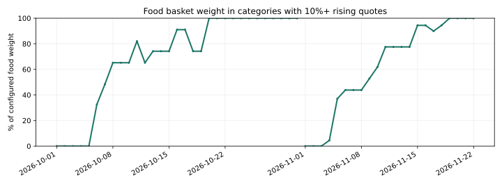

# Açık Sepet · ECB repricing experiment

**Latest: 2026-11-15 (provisional month-to-date)** · 1692 comparable store-SKU quotes · 100.0% basket-weight coverage.

**Increased:** 21.02% · **Decreased:** 20.27% · **Unchanged:** 58.71%.

**Food-only increase frequency:** 20.79% · decrease frequency: 20.65%.

**Food breadth (categories with ≥10% increasing):** 94.4% of configured food weight.

**Quality warning:** 324 / 1691 raw matched quotations (19.2%) changed by ≥20%; 3 almost doubled. Promotions and other outliers remain under investigation.

**All-basket matched previous-month same-day change:** -0.75 pp (versus 2026-10-15).

| Category | Quotes | Increases | Decreases | Avg rise | Avg fall |
|---|---:|---:|---:|---:|---:|
| Ekmek, tahıllar ve makarna | 166 | 33.7% | 22.9% | +17.86% | -24.84% |
| Et ve et ürünleri | 98 | 10.2% | 23.5% | +17.63% | -18.11% |
| Balık ve deniz ürünleri | 33 | 15.2% | 6.1% | +18.26% | -25.10% |
| Süt ürünleri ve yumurta | 231 | 30.3% | 8.7% | +7.18% | -13.79% |
| Yağlar | 100 | 16.0% | 17.0% | +41.44% | -20.21% |
| Meyve | 40 | 20.0% | 32.5% | +25.62% | -16.59% |
| Sebze | 57 | 22.8% | 38.6% | +31.34% | -17.04% |
| Şeker, tatlı ve atıştırmalık | 244 | 16.0% | 11.5% | +18.22% | -17.49% |
| Diğer gıda | 175 | 17.7% | 15.4% | +29.35% | -20.34% |
| Alkolsüz içecekler | 187 | 7.0% | 16.0% | +9.02% | -19.72% |
| Ev temizlik sarf malzemeleri | 141 | 26.2% | 15.6% | +35.21% | -36.35% |
| Kişisel bakım ve kağıt ürünleri | 220 | 16.8% | 20.0% | +16.24% | -29.59% |

Method: matched product **and** store, normalized price, same pack size;
fresh source (≤1 day), previous month-end price within seven days,
Sale-like V-shaped reductions suppressed only after an observed rebound;
this heuristic does not prove any promotion. Current sales may remain.
Excludes extreme changes(below −50% or above +100%). Category weighting uses Açık Sepet
**research weights**, not official TÜİK/HICP weights.
Coverage is based on categories with at least five comparable quotes.
This is not official inflation or the ECB Daily Price Dataset.
